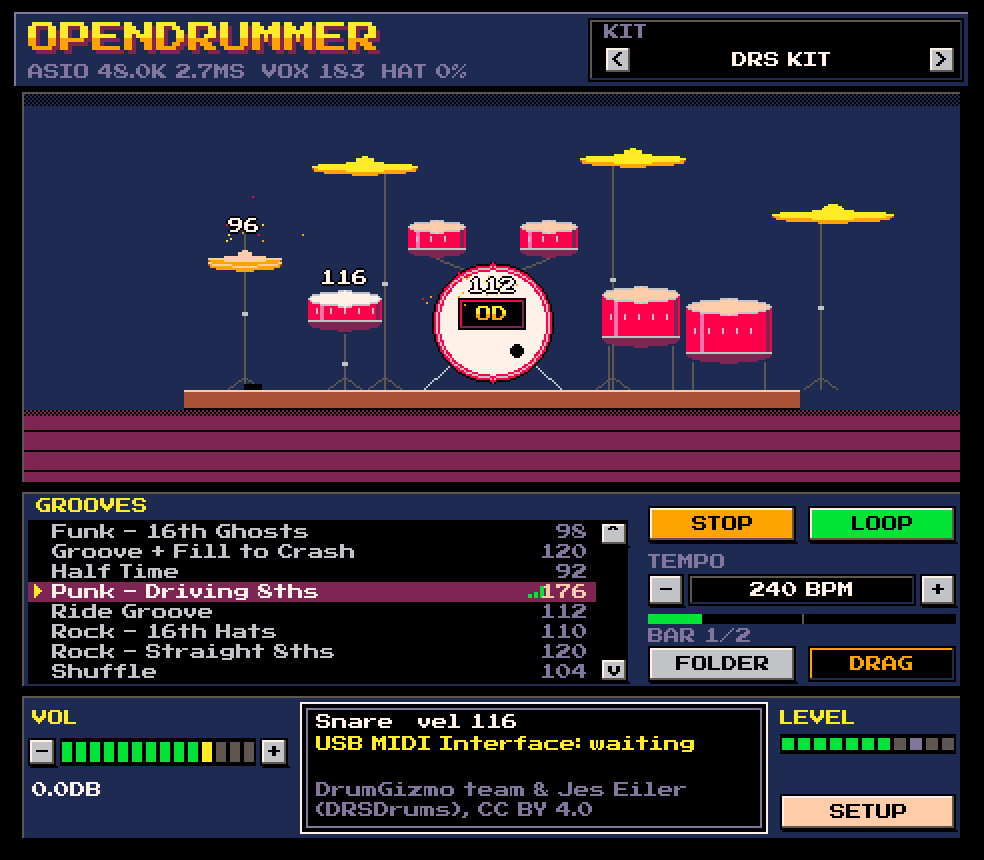
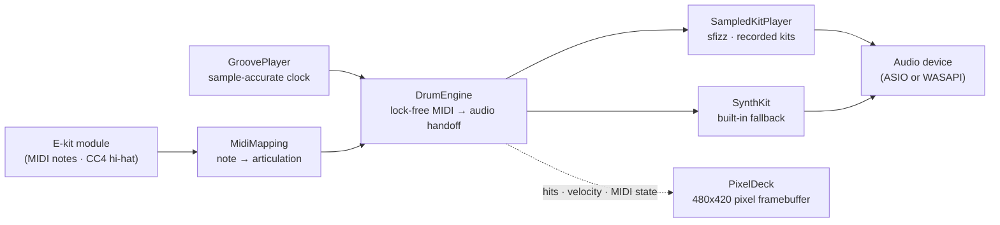

<div align="center">


# OpenDrummer

[](LICENSE)

### Plug in an electronic drum kit. Play real recorded drums.

**A Windows drum sampler for e-kits: multi-sampled acoustic kits through sfizz, a groove player, and a retro pixel-art screen that shows every hit.**


**[Build](#build) · [Get the kits](#get-the-drum-kits) · [Play](#play) · [How it works](#how-it-works) · [Troubleshooting](#troubleshooting) · [FAQ](#faq)**



</div>

---

Plug in a kit, pick a drum set, play. OpenDrummer turns a Roland-style e-kit into recorded acoustic drums, with velocity layers, round robins, microphone mixes, and cymbal chokes, and shows you exactly what your pads are sending while you play.

## What it does

- **Plays recorded drum kits** through [sfizz](https://sfz.tools/sfizz/). Three free kits work out of the box: a neutral all-rounder, a battered 1980s kit for punk, and a double-kick kit with a china for metal.
- **Maps an e-kit's pads to each kit.** Defaults match a Roland TD module: snare rim and cross-stick, tom rims, cymbal bow and edge, ride bell, the hi-hat pedal (CC4), and hand-choking a cymbal.
- **Plays grooves.** Eleven starter grooves are written to `Documents\OpenDrummer\Grooves` on first run. Point it at any folder of MIDI files, change the tempo, loop, or drag a groove straight into a DAW.
- **Shows what is happening.** Pieces flash when struck and the velocity floats up off the drum. A MIDI line says whether your module is connected, sending, or hitting notes the kit does not know.
- **Keeps working.** Remembers your audio and MIDI devices, reconnects the drum module if it drops or is replugged, and uses ASIO when it is available.

## Build

Requirements:

- Windows 10 or 11 (the only platform it has been built and tested on)
- Visual Studio 2022 or Build Tools 2022, with the **Desktop development with C++** workload
- CMake 3.28+, Ninja, and Git
- An electronic drum kit connected over MIDI, and an audio interface

```bat
git clone https://github.com/AlienWalker1995/OpenDrummer.git
cd OpenDrummer
build.cmd
```

The first configure downloads JUCE and sfizz (both pinned), so it takes a while. The app lands in `build\OpenDrummer_artefacts\RelWithDebInfo\OpenDrummer.exe`, and `install-shortcut.ps1` adds Desktop and Start Menu shortcuts.

> Clone to a short path such as `C:\src\OpenDrummer`. sfizz's dependencies nest deeply, and a long path can push build files past Windows' 260-character limit (`C1083: Cannot open compiler generated file`).

### Low-latency ASIO (optional)

Without ASIO, audio goes through WASAPI, which works but adds latency you can feel when drumming. The Steinberg ASIO SDK has been dual licensed (GPLv3 or proprietary) since October 2025, so it is compatible with this project, but it is not redistributed here. Download it from [Steinberg](https://www.steinberg.net/developers/) and build with:

```bat
set ASIO_SDK_DIR=C:\path\to\asiosdk
build.cmd
```

## Get the drum kits

The kits are about 3.5 GB and belong to their authors, so they are not in this repository. Download them into `Kits\` with:

```powershell
powershell -ExecutionPolicy Bypass -File fetch-kits.ps1
```

| Kit | Style | Licence |
|---|---|---|
| [DRS Kit](https://github.com/sfzinstruments/DrumGizmo.DRSKit) | Handmade kit with Paiste cymbals: jazz to rock | CC BY 4.0 |
| [Big Rusty Drums](https://github.com/sfzinstruments/karoryfer.big-rusty-drums) | Loud 1980s kit with a china: punk | CC0 |
| [MuldjordKit](https://github.com/sfzinstruments/DrumGizmo.MuldjordKit) | Double kick and a china: metal | CC BY 4.0 |

With no kits installed, OpenDrummer falls back to built-in synthesised kits, so it still makes a sound.

Kits load much faster from an SSD: each is several thousand small sample files, so a first load from a hard disk can take minutes where an SSD takes seconds. To keep the kits on another drive, move the `Kits` folder and add its path to `%APPDATA%\OpenDrummer\OpenDrummer.settings`:

```xml
<VALUE name="kitsFolder" val="D:\OpenDrummerKits"/>
```

## Play

| Control | Does |
|---|---|
| `<` / `>` next to **KIT** | Switch kits |
| **↑** / **↓** | Choose a groove |
| **Space** or **Enter**, or double-click a groove | Play / stop |
| Drag the **VOL** bar, or scroll over it | Volume (double-click resets to 0 dB) |
| Drag the tempo up or down, or scroll over it | Tempo |
| **DRAG** | Drag the selected groove into a DAW as a MIDI file |
| **SETUP** | Audio and MIDI devices, velocity curve, hi-hat pedal direction, live MIDI monitor |

If the hi-hat opens when your foot is down, tick **Invert hi-hat pedal** in SETUP.

## How it works



Three design rules carry the whole app:

- **The audio thread never waits.** MIDI arrives on a JUCE callback thread and audio renders on the driver's thread; triggers cross between them without locks, so a busy UI or a kit load can never cause a dropout.
- **Kits swap, they do not reload in place.** A kit loads on a worker thread into a fresh sfizz instance, and the finished instance is swapped in, so you keep playing the old kit until the new one is ready.
- **Grooves are clocked in samples.** The groove clock lives on the audio thread, so programmed hits cannot drift or jitter against the audio they trigger.

The screen is one 480x420 indexed framebuffer scaled by a whole number, so the kit, text, and buttons all share a single pixel grid. It owns no app state: it draws a snapshot each frame and reports user actions back.

## Troubleshooting

The MIDI line in the status box says which kind of problem it is:

| Status | Meaning | Fix |
|---|---|---|
| **waiting** | The input is open but nothing is arriving | Check the module is on and its MIDI OUT goes to your interface's IN |
| **unmapped** | Notes are arriving on pads the kit does not know | SETUP's MIDI monitor shows the note numbers |
| **No MIDI input** | No input is selected | Open SETUP and tick your module |

While a kit loads, the header counts the seconds. The first load after starting Windows reads every sample off the disk, so it is much slower than later ones (see `kitsFolder` above for moving kits to an SSD).

Logs are written to `%APPDATA%\OpenDrummer\`:

| Log | Contains |
|---|---|
| `devices.log` | Audio and MIDI devices found at launch |
| `midi.log` | MIDI inputs opened, and any that failed |
| `kits.log` | Which kits folder was used, kit load times, and failures |

### Offline rendering

Two command-line modes play every drum of every kit and write WAV files, for checking kits without a drum kit or audio device:

```bat
OpenDrummer.exe --render-sampled C:\renders   :: recorded kits, through sfizz
OpenDrummer.exe --render-kits C:\renders      :: built-in synthesised kits
```

## FAQ

**Does it work with my kit?** Any e-kit that sends MIDI notes should play. The default pad map matches a Roland TD module; SETUP's MIDI monitor shows what other modules send.

**Is it a VST plugin?** No. It is a standalone app, built for sitting at the kit and playing. Grooves still drag into a DAW as MIDI.

**Why are the kits not included?** They are about 3.5 GB and belong to their authors under their own licences. `fetch-kits.ps1` downloads them from the source repositories.

**macOS or Linux?** Not yet. The code is JUCE and sfizz, both cross-platform, but only Windows has been built and tested.

## Repo layout

```
Source/                  the app: engine, kits, MIDI mapping, groove player, pixel UI
Resources/               icons and the Press Start 2P font (OFL)
docs/screenshot.png      README screenshot
CMakeLists.txt           build; JUCE and sfizz fetched and pinned at configure time
build.cmd                one-step Windows build
fetch-kits.ps1           downloads the three sampled kits into Kits\
install-shortcut.ps1     Desktop and Start Menu shortcuts
THIRD_PARTY_NOTICES.md   licences and credits for JUCE, sfizz, the font, and the kits
```

## Licence

OpenDrummer is released under the [GNU Affero General Public License v3.0](LICENSE).

It uses JUCE (AGPLv3), sfizz (BSD 2-Clause), and the Press Start 2P font (SIL Open Font License). The drum kits keep their own licences and credits; see [THIRD_PARTY_NOTICES.md](THIRD_PARTY_NOTICES.md).
